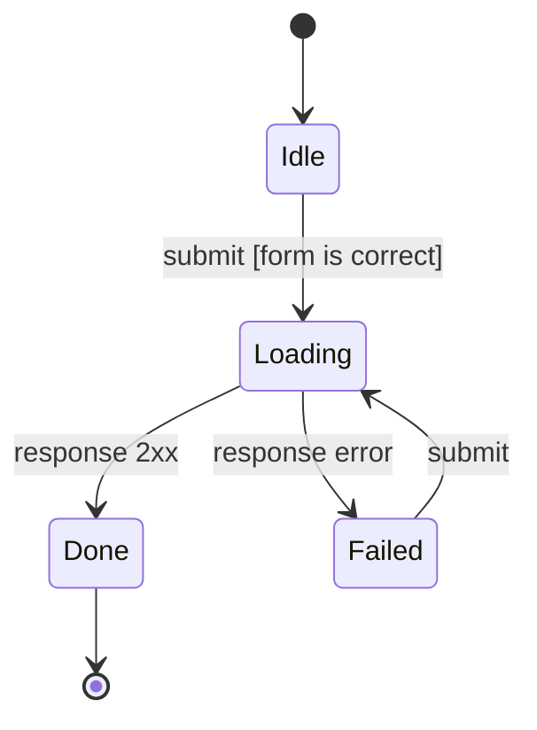

An implicit state machine is state logic that the code does not model as an explicit state machine. This skill gives a report. Do not change the code.

# What to find

A state machine is an entity or a process with these three properties:

- It has distinct states.
- Events change its state.
- Its state controls what can occur next.

Put a candidate in the report only if it has all three properties. A form alone is not a state machine. These forms are clues:

- A group of boolean flags, for example `isLoading`, `isError` and `isSubmitted`.
- A status field or a state field (an enum, a string or a database column) that the code changes in more than one location.
- An `if`/`else` chain or a `switch` chain that makes a decision from a combination of conditions.
- A flow with more than one step, for example a wizard, a checkout, an onboarding flow or an authentication flow.
- The lifecycle of a connection or of a session.

# Procedure

1. If the user gives a path, examine only the code in that path.
2. If the user does not give a path, examine all of the application.
3. Search the code for each form in "What to find". Make a list of the state machines.
4. Trace each transition through the layers in the search area: the frontend, the backend and the database schema.
5. If you examined only a part of the search area, give the paths that you examined.
6. Find the tests for each transition.
7. Write the report. Use the structure in "Report".
8. If you are not sure that a state, a transition or a problem is real, tell the user.

# Report

## Part 1: State machines

For each state machine, give this information:

1. The name and the purpose: the entity or the process that the state machine describes.
2. All states. Include a state that only a combination of flags shows, if the code can get to it.
3. All transitions. For each transition, give the source state, the target state, the event that starts it and its guards or conditions.
4. The code location (`file:line`) of each transition.
5. A Mermaid `stateDiagram-v2` diagram.

Use this form for the diagram:

## Part 2: Problems

Use this list to look for possible problems. An item in the list is not always a problem. For example, an error state can be the correct last state. For each problem, give the code location and the evidence that the behavior is not correct. If you find no test, tell the user where you searched.

- A combination of states that is impossible or not correct, but that the code lets occur.
- A transition that is not there, for example no path out of an error state.
- A state with no transition out of it, or a state that the code cannot get to.
- A transition without a guard.
- A transition that a direct call to an API or a function can start, without the steps that must come before it.
- A race condition: updates at the same time that can make the state incorrect.
- A difference between layers: the frontend, the backend and the database do not agree about the states or the transitions.
- A transition that has no test.

## Part 3: Risk and recommendations

1. Rank the state machines by the effect of the problems that you found. Put the highest risk first.
2. Give the reason for each rank. Two state machines can have the same rank.
3. Recommend to refactor a state machine into an explicit state machine only if this corrects a problem that you found.
4. Recommend a form that agrees with the language and the project. Tell the user how the change helps.
